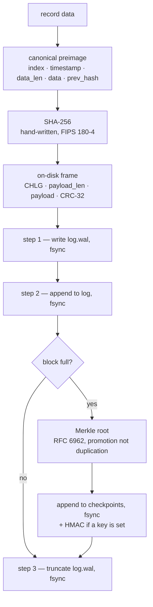

# ChainLog

**A tamper-evident audit log engine in C++17.**

> Status: working. SHA-256, the Merkle tree, the record format and the
> write-ahead log are all written by hand; OpenSSL appears only as a test
> oracle. `make test` runs 421 assertions plus 1,432 cross-checks against
> independent implementations.

Any edit, deletion, reordering or truncation of past records is detectable,
and you can prove a single record is in the log with a 690-byte Merkle proof
that checks out without access to the log at all.

## The guarantee, stated precisely

ChainLog **detects** tampering. It does not **prevent** it.

Anyone who can write to the log file can change it. What they cannot do is
change it without leaving evidence — *provided at least one value from the log
has been kept somewhere they could not reach*. That last clause is the whole
design, and `docs/THREAT_MODEL.md` is 250 lines about why.

What that buys you, concretely:

| | |
|---|---|
| a flipped byte | caught by the frame's CRC-32 |
| a byte flipped and the CRC repaired | caught by the record's SHA-256 |
| a record rewritten and re-hashed | caught by the next record's `prev_hash` |
| the whole tail re-linked | caught by the sealed Merkle roots |
| the roots re-sealed too | caught by an HMAC the attacker cannot forge |
| the signatures stripped | caught by a verifier that demands them |
| the tail cut off at a record boundary | caught **only** by a published anchor |
| all of the above, with the signing key | caught **only** by a published anchor |

Every row is a passing test, including the two that say "only by an anchor".
`make demo` demonstrates all of them on a 1,000-record log.

## Architecture



`verify` walks the same files in the opposite direction and stops at the
**first** failure, reporting its record index, byte offset and reason:

1. frame magic, payload length, and enough bytes left → `bad-magic`,
   `bad-frame-length`, `torn-tail`
2. CRC-32 over the payload → `bad-crc`
3. `data_len + 88 == payload_len` → `bad-frame-length`
4. `index == expected` → `bad-index`
5. `prev_hash` equals the previous record's **recomputed** hash → `broken-link`
6. `SHA256(preimage)` equals the stored hash → `bad-hash`
7. each completed block's root equals its checkpoint → `bad-checkpoint`
8. every checkpoint signed and valid, when a key is given → `bad-checkpoint`
9. every anchor present and matching → `anchor-missing`, `anchor-mismatch`

Step 5 chains on the **recomputed** hash, never the stored one. That is what
makes blame land correctly: editing record *i*'s stored hash field reports
`bad-hash` at exactly *i*, rather than a broken link at *i+1* — the one record
that was not touched.


A log is a **directory**, not a file:

```
mylog/
├── log           32-byte header, then one framed record per append
├── log.wal       32-byte header, then at most one staged record
├── checkpoints   32-byte header, then one sealed Merkle root per block
└── lock          flock target, so two writers cannot interleave
```

Each framed record on disk:

```
+--------+-------------+-------+-----------+----------+------+-----------+------+--------+
| "CHLG" | payload_len | index | timestamp | data_len | data | prev_hash | hash | crc32  |
|   4    |    4 LE     | 8 LE  |   8 LE    |   8 LE   |  n   |    32     |  32  |  4 LE  |
+--------+-------------+-------+-----------+----------+------+-----------+------+--------+
                       \------------- hashed preimage ------------------/
```

The bytes that get **hashed** and the bytes that go **on disk** are
deliberately different. Framing stays outside the hash, so it can change in a
future format version without invalidating a single historical hash.
`docs/FORMAT.md` specifies every field, with a real hex dump.

## Build and run

No dependencies beyond a C++17 compiler, `make` and `python3` (tests only).
No CMake, no Docker, no package manager.

```bash
git clone https://github.com/Kunal0626/chainlog.git && cd chainlog && make
```

```bash
make test
```

```bash
make demo
```

```bash
make bench
```

Tested on macOS 26.6 / Apple clang 21 / GNU Make 3.81 (the version Apple
ships, so the Makefile avoids anything newer). The test build turns on
AddressSanitizer and UndefinedBehaviorSanitizer; the release build and the
benchmarks do not, because measuring a sanitizer is not measuring the log.

## Usage

All output below is real, captured from the commands shown.

### Append and verify

```console
$ chainlog --dir mylog append "user alice granted admin on project-7"
index=0 hash=f995623e71d5d33ada12e16e7e3fa74f7aa6bd694ab9fd6fe5d34dfe04af3891

$ chainlog --dir mylog append "user bob revoked from project-7"
index=1 hash=90f8897c8310a21b314aa4ac2c964d8c39006c195c529e271e98645ceb85829e

$ chainlog --dir mylog verify
ok: 2 record(s) verified
anchors_checked=0
signatures_required=0
```

`verify` reports what it actually checked, because "ok" means a great deal
more with a key and an anchor behind it than without.

### Bulk import, checkpoints, and an inclusion proof

```console
$ seq 1 20 | sed "s/^/event /" | chainlog --dir mylog --block-size 8 import
imported=20
index=19 hash=923dc49319776c217316999e71805f8c1c450e589573ea47546f1c34fcee9c23

$ chainlog --dir mylog checkpoints
block=0 first_index=0 last_index=7 root=ca2a77e2e3df7218ef0c4d9851f3278890f1eb1156456d1c19942af9b6cf592f
block=1 first_index=8 last_index=15 root=91671ff8949595d7f3f03cf8c28f11003e386fd0bb9721c1ada34a7ee65556be

$ chainlog --dir mylog prove 5
index=5
first_index=0
last_index=7
tree_size=8
leaf_index=5
timestamp_ns=1794135988100153000
data_hex=6576656e742036
prev_hash=2767ccc2c9cb4a09724337580ee8f8b4b177a17115e28bceff01636d91a32724
record_hash=79889144b86e045759bee997d5c384312956dc4e7768428830724a73c9da2ffe
leaf_hash=6a4e89bc82417eeffcdce7a45e9b87cffd15bfc3fec7b9d9ef9693a24d5c4bb0
root=ca2a77e2e3df7218ef0c4d9851f3278890f1eb1156456d1c19942af9b6cf592f
proof_steps=3
proof=010000000000000000080000000000000005000000000000000300256a97022cf6...
verify_command=chainlog --dir mylog verify-proof 5 hex:6576656e742036 ca2a77e2... --timestamp 1794135988100153000 --prev-hash 2767ccc2...
```

That last line is paste-ready. Running it **with no access to the log** —
`verify-proof` never opens the log directory:

```console
$ chainlog verify-proof 5 hex:6576656e742036 ca2a77e2... <proof> --timestamp ... --prev-hash ...
ok: record 5 is leaf 5 of 8 under root ca2a77e2e3df7218ef0c4d9851f3278890f1eb1156456d1c19942af9b6cf592f
record_hash=79889144b86e045759bee997d5c384312956dc4e7768428830724a73c9da2ffe
```

`verify-proof` needs `--timestamp` and `--prev-hash` as well as the data,
because a Merkle leaf commits to the **whole record**, not just its payload.
Accepting a bare leaf hash instead would hide exactly the property that makes
the proof worth anything.

### Anchoring

```console
$ chainlog --dir mylog anchor
19:923dc49319776c217316999e71805f8c1c450e589573ea47546f1c34fcee9c23

$ chainlog --dir mylog verify --anchor 19:923dc49319776c217316999e71805f8c1c450e589573ea47546f1c34fcee9c23
ok: 20 record(s) verified
anchors_checked=1
signatures_required=0
```

Keep that one line anywhere the attacker cannot reach — a ticket, a git
commit, an email to yourself — and truncation and wholesale rewriting both
become detectable. Nothing inside the directory can do that for you.

### Signed checkpoints

```bash
openssl rand -hex 32 > ~/chainlog.key && chmod 600 ~/chainlog.key
```

```bash
chainlog --dir mylog --key-file ~/chainlog.key verify
```

With a key, `verify` **requires** every checkpoint to be signed and valid. The
requirement lives in the verifier rather than the file, because an attacker
with write access can always rewrite a checkpoint as unsigned — only a
verifier that insists catches that.

Exit codes: `0` ok, `1` does not verify, `2` usage or I/O error. Keeping `1`
and `2` apart matters: "I checked and it is bad" and "I could not check" are
different answers, and a script that treats them alike will eventually report
a permissions problem as a security incident.

## The tamper demo

`make demo` builds a 1,000-record log and attacks it seven ways. Every case
asserts its expected verdict, so it is a test as well as a demonstration. The
attacks come from `demo/attacker.py`, which shares no code with ChainLog —
a real attacker would not be using our code either.

Captured output, abridged from [`demo/output.txt`](demo/output.txt):

```console
$ demo/attacker.py flip demo/work/a 637
| flipped one bit in record 637's data (byte offset 70134); the frame CRC was left alone
$ chainlog --dir demo/work/a verify
| chainlog: verification FAILED: bad-crc at index 637 (byte offset 70102): crc32 stored 3a07e086, computed bf9aa9b7
| exit status 1

$ demo/attacker.py delete demo/work/b 500
| deleted record 500's whole frame (110 bytes at offset 55032)
$ chainlog --dir demo/work/b verify
| chainlog: verification FAILED: bad-index at index 500 (byte offset 55032): expected index 500, frame says 501
| exit status 1

$ demo/attacker.py swap demo/work/c 300 301
| exchanged the frames of records 300 and 301
$ chainlog --dir demo/work/c verify
| chainlog: verification FAILED: bad-index at index 300 (byte offset 33032): expected index 300, frame says 301
| exit status 1

$ demo/attacker.py truncate-mid demo/work/d1 40
| cut 40 bytes off the end of the log (110032 -> 109992), part-way through the last frame
$ chainlog --dir demo/work/d1 verify
| chainlog: verification FAILED: torn-tail at index 999: frame claims 110 bytes, only 70 left at end of file
| exit status 1

$ demo/attacker.py relink demo/work/e 637
| rewrote record 637 and re-linked every record after it; the chain is now internally consistent
$ chainlog --dir demo/work/e verify
| chainlog: verification FAILED: bad-checkpoint at index 512: block 4 (records 512..639) has root 7f4aa4bc... but the checkpoint says 7671b344...
| exit status 1
```

And the two cases a hash chain **cannot** see:

```console
$ demo/attacker.py truncate demo/work/d2 768
| cut the log from 1000 records to 768, at a frame boundary, and trimmed the checkpoints to 6
$ chainlog --dir demo/work/d2 verify
| ok: 768 record(s) verified              <-- not caught
| exit status 0
$ chainlog --dir demo/work/d2 verify --anchor 999:ca53211b...
| chainlog: verification FAILED: anchor-missing at index 999: the log holds 768 record(s), so there is no record 999
| exit status 1

$ demo/attacker.py relink demo/work/f 637 && demo/attacker.py reseal demo/work/f
$ chainlog --dir demo/work/f verify
| ok: 1000 record(s) verified              <-- not caught
| exit status 0
$ chainlog --dir demo/work/f verify --anchor 999:ca53211b...
| chainlog: verification FAILED: anchor-mismatch at index 999: record 999 hashes to f5f208fd... but this anchor says ca53211b...
| exit status 1
```

Those two are the point of the whole project. A hash chain proves that what is
present has not changed. It cannot prove that nothing is missing, and it
cannot prove anything at all to someone who controls every file involved.

## Measured results

Full report with the spread and the machine details:
[`bench/RESULTS.md`](bench/RESULTS.md), generated entirely by `make bench` —
no number in it is typed by hand.

**Machine:** Apple M3 (8 cores), 8 GiB, macOS 26.6.2 (25G83), APFS, Apple
clang 21.0.0, `-O2`, no sanitizers. Medians over 5 runs.

| measurement | result |
|---|---|
| SHA-256, hand-written | **345 MB/s** (`shasum` 413, `openssl` 2133) |
| append, `--sync every` (3 fsyncs) | **164/s**, 6.1 ms each |
| append, `--sync batch:1000` | **29,129/s** |
| append, `--sync none` | **42,017/s** |
| verify 100,000 records (19.1 MiB) | **0.166 s** — 601k records/s, peak RSS 2.3 MiB |
| verify 1,000,000 records (190.7 MiB) | **1.72 s** — 583k records/s, peak RSS 2.3 MiB |
| Merkle proof, 1,024 leaves | 10 steps, 360 B, **7.4 µs** to build + verify |
| Merkle proof, 1,048,576 leaves | 20 steps, 690 B, **8.9 µs** to build + verify |

Three of these are worth a second look.

**Peak RSS is 2.3 MiB at 100k records and 2.3 MiB at 1M.** Identical, because
`verify` streams frames and holds only the current block's 1,024 leaf hashes —
32 KiB whatever the log's length. That is a design decision showing up as a
measurement rather than as an adjective.

**The proof went from 10 steps to 20 for a tree 1,024× larger.** Ten doublings
added ten hashes: O(log n) measured, not asserted.

**The hand-written SHA-256 is about 6× slower than OpenSSL.** OpenSSL uses the
ARMv8 cryptographic extensions — single instructions for the round function —
and this does not. That is the honest price of the project's main constraint,
and it is not the bottleneck anyway: `verify` runs at 111 MB/s because it is
bounded by per-record framing, not by hashing.

## How it is tested

`make test` runs **421 assertions and 1,432 cross-checks** in about 46
seconds:

| suite | count | what it covers |
|---|---|---|
`make unit` | 144 cases | every module, under ASan + UBSan |
`make cli` | 119 checks | output shapes and exit codes, end to end |
`make crash` | 147 checks | the real binary killed at each point in the append protocol |
`make demo` | 11 cases | the tamper ladder |
`make oracle` | 1,432 comparisons | four independent implementations |

The oracles are the part I would point at first. A test suite written against
the same code it tests will happily agree with a construction that only exists
in that code's head, so each hand-written primitive is checked against
somebody else's implementation:

- **SHA-256** — 1,197 comparisons against `shasum` and `openssl`, at every
  input length from 0 to 130 and beyond
- **CRC-32** — 86 comparisons against python's `zlib`
- **HMAC-SHA256** — 121 comparisons against python's `hmac`
- **the format itself** — `tests/oracle_format.py` is a parser written from
  `docs/FORMAT.md` using python's `hashlib` and RFC 6962's *recursive*
  `MTH`/`PATH`, where the C++ builds trees iteratively. `make oracle` requires
  the two to emit **byte-identical proof blobs**, and to reach the same
  diagnosis on four kinds of damage.

Byte-identical proofs between a recursive and an iterative implementation is
much stronger evidence than "both say OK": it means the fast build really is
RFC 6962's tree and not merely *a* tree.

Crash recovery is tested by killing the real shipping binary — `_exit(99)`
under `$CHAINLOG_CRASH_AT`, not a special build — at each of the three points
in the append protocol, including twelve consecutive crash-and-recover rounds.

## Repository layout

```
include/ src/     the engine, 4,893 lines
  sha256           SHA-256 (FIPS 180-4), streaming
  crc32            CRC-32/ISO-HDLC
  hmac             HMAC-SHA256 (RFC 2104)
  record           the preimage, the frame, the file header
  merkle           RFC 6962 tree, proofs, the proof wire format
  checkpoint       sealed roots, signed and unsigned
  wal              the write-ahead log
  log              append, recovery, verify, prove
  fileio           F_FULLFSYNC, directory fsync, short-write loops
  faultinject      $CHAINLOG_CRASH_AT
tests/            6,127 lines — unit suite, 4 oracles, CLI and crash scripts
bench/            974 lines — 5 programs plus the harness that writes RESULTS.md
demo/             663 lines — the tamper demo and the attacker tool
docs/             1,010 lines — FORMAT.md, THREAT_MODEL.md, INTERVIEW_NOTES.md
tools/            cl-sha256, cl-crc32, cl-hmac — used by the oracle scripts
```

## Limitations and future work

Stated plainly. Several of these are pinned as *passing tests* named
`*_is_NOT_detected`, so they cannot quietly stop being true.

**Properties the format does not have**

- **Truncation is invisible without an anchor.** A prefix of a valid chain is
  a valid chain. Nothing inside the file records how long it was supposed to
  be.
- **A full rewrite is invisible without an anchor or a key.** An attacker with
  write access to everything controls both sides of every internal check.
- **Signatures do not catch truncation.** Cutting the log at a block boundary
  and dropping the matching checkpoints leaves every surviving signature
  genuine. Anchors catch truncation; keys do not.
- **A proof pins the leaf position exactly but not the exact tree size.** The
  path shape is the bits of the leaf index, so position is committed; tree size
  only changes the shape where it changes the promotion pattern. Forging
  membership is still infeasible, but a proof's self-reported `tree_size` is
  convenience, not a committed fact — the size that counts comes from the
  trusted checkpoint.
- **No confidentiality.** Record data is plaintext. Encrypt before appending
  if it matters.
- **Timestamps are informational.** `verify` does not require them to
  increase, because NTP legitimately steps the clock backwards. Ordering comes
  from `index` and the chain.
- **`flock` is advisory.** It stops two cooperating ChainLog processes from
  interleaving. It does nothing about `dd`, and it is historically unreliable
  over NFS.

**Things that are simply not built yet**

- **No automatic repair of a torn tail under batched sync.** With
  `--sync every` a torn tail always has its record in the WAL, so recovery is
  unambiguous. Under `batch:N` or `none` a crash can leave a torn frame with
  an empty WAL, which `verify` reports and nothing fixes. A `chainlog recover`
  that truncates back to the last good frame is the obvious addition.
- **`prove` walks the log from the start** to reach a block, so it is O(records
  before it). Storing each block's byte offset in its checkpoint would make it
  O(block) — but that is an optimisation without a measurement behind it, and
  the measurement has not been taken.
- **`read_checkpoints` loads the whole file.** About 60 KB per million
  records, so it does not matter yet; a log large enough would need streaming.
- **`block_size` is fixed at creation.** No migration path.
- **No `mmap` read path.** Would likely help `verify` on cold caches, which is
  also not measured.
- **No Ed25519 signing.** HMAC means the verifier needs the same secret the
  signer used. A public-key signature would let anyone verify without being
  able to forge.
- **Benchmarks are warm-cache, single-threaded, one machine.** Contention,
  cold reads and other hardware are all unmeasured and listed as such in
  `bench/RESULTS.md`.

## Documentation

| | |
|---|---|
[`docs/FORMAT.md`](docs/FORMAT.md) | byte-level specification, with a real hex dump and the reasoning behind each field |
[`docs/THREAT_MODEL.md`](docs/THREAT_MODEL.md) | four attacker tiers, why CRC-32 is not a MAC, where anchors and keys each stop |
[`docs/INTERVIEW_NOTES.md`](docs/INTERVIEW_NOTES.md) | every design decision with the alternatives that were rejected, and the hardest questions with answers |
[`bench/RESULTS.md`](bench/RESULTS.md) | measured numbers, machine specs, and an explicit "not measured" section |
[`demo/output.txt`](demo/output.txt) | the captured tamper demo transcript |
[`docs/RESUME_BULLETS.md`](docs/RESUME_BULLETS.md) | which numbers this project can actually support, and which it cannot |

## License

MIT. See [LICENSE](LICENSE).

---
Part of my portfolio: [github.com/Kunal0626](https://github.com/Kunal0626)
